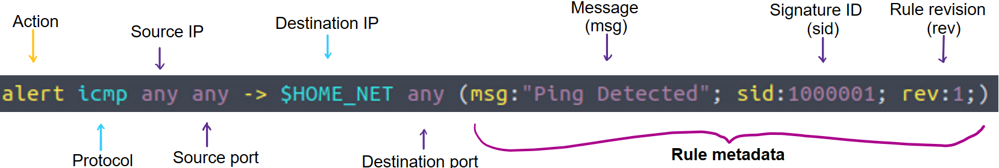
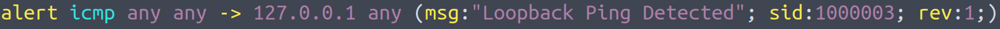
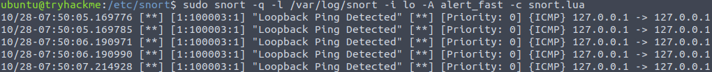
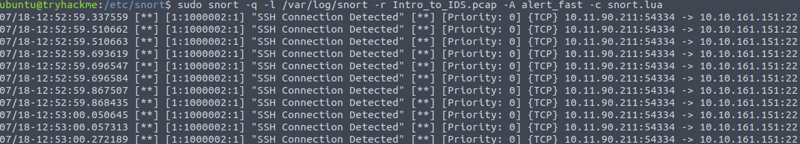

## What is an IDS

IDS (Intrusion Detection System) acts as a critical secondary security layer that reinforces the concept of Defense in Depth. For instance, if an adversary successfully bypasses the perimeter firewall, the IDS can still flag malicious activity through signature or anomaly-based detection. 

## Types of IDS

### IDS can be deployed in two distinct architecture models
- **Host Intrusion Detection System (HIDS):** Deployed locally on individual endpoints, HIDS agents monitor host-specific activity, system logs, and file integrity. While presenting scalability challenges in large enterprise environments, this model delivers unmatched visibility into host-level telemetry. 
- **Network Intrusion Detection System (NIDS):** Positioned at strategic network bottlenecks or span ports, NIDS appliances inspect traffic traversing the wire regardless of the underlying endpoints. Though lacking the granular process-level visibility characteristic of HIDS, NIDS provides centralized, macro-level threat visibility across the entire network segment.

### Detection Modes
- **Signature-Based Detection:** Leveraging static threat intelligence and signature databases, this model excels at detecting known malicious patterns with high processing speeds and low false-positive rates. However, it remains entirely ineffective against zero-day payloads lacking predefined signatures.
- **Anomaly-Based Detection:** Profiling baseline operational behavior, this engine flags statistical deviations as potential threats. While uniquely suited to catch novel zero-day attacks, it frequently suffers from operational alert fatigue due to a high rate of false positives.
- **Hybrid IDS:** Integrating signature matching with behavioral analysis, hybrid architectures balance the speed and precision of signatures with the comprehensive coverage of anomaly detection.

## IDS Example: Snort

Snort is one of the most popular open-source IDS platforms. It relies heavily on signature-based detection and stateful protocol analysis to identify known and emerging threats. Snort comes with a comprehensive set of pre-written rules which can be easily tuned for our environment.

### Modes of Snort
- **Packet sniffer mode:** Bypasses the detection engine entirely. Instead of evaluating traffic against rules, it simply captures and outputs packets to the console or file, making it ideal for raw traffic inspection and basic troubleshooting.
- **Packet logging mode:** Logs network traffic directly to disk (typically as a PCAP file). It records raw network packets for offline inspection, allowing analysts to perform post-incident triage in tools like Wireshark.
- **Network Intrusion Detection System mode:** Serves as Snort's primary mode. It monitors network traffic in real time and evaluates packets against loaded rule files to detect matches with known attack signatures.

## Snort Usage

### Snort Files
Snort commonly uses `/usr/local/etc/snort` to store its configuration files. The most critical file is `snort.lua`, which defines which rule files to enable, which network ranges to monitor (such as HOME_NET), and various global engine settings. The corresponding detection rules are stored in the `rules/` directory. 

### Rule Format
Let's inspect a basic rule intended to detect ICMP traffic (commonly associated with ping). 


Rule commonly consists of several elements:
- **Action:** Defines the action Snort should take when the rule triggers. Available options depend on whether Snort is running in inline mode or in passive monitoring mode (e.g., `alert`, `drop`, `block`, `log`).
- **Protocol:** Specifies the network protocol evaluated by the rule (e.g., `tcp`, `udp`, `icmp`, `ip`).
- **Source IP:** Indicates the source IP address originating the traffic. 
- **Source port:** Specifies the port from which the traffic originates.
- **Destination IP:** Specifies the destination to which the matching traffic is intended. 
- **Destination port:** Specifies the port the traffic would reach. 
- **Message (msg):** The descriptive message displayed when the rule triggers.
- **Signature ID (sid):** A unique identifier that distinguishes different rules.
- **Rule revision (rev):** The rule's version number, which is incremented whenever the rule is modified to help track changes.

**To create your own custom rules, just edit the local.rules file.**

### Rule Testing


Once the custom rule above is added, we can execute the Snort rule using the following command:
```bash
sudo snort -q -l /var/log/snort -i lo -A alert_fast -c /etc/snort/snort.lua
```
- `-q` Suppresses the normal banner and status output on the console screen, keeping the terminal clean.
- `-l` Specifies the logging directory where Snort will save its alert logs and packet data.
- `-i` Tells Snort which network interface to monitor. 
- `-A` Sets the alert mode to fast. This configures Snort to output a quick, streamlined one-line alert message for each detected rule match (rather than full packet dumps).
- `-c` Specifies the path to the main configuration file that Snort should use. 

This is what our output should look like:


Additionally, Snort can be deployed in offline mode to analyze historical network traffic captured within PCAP files using the following command:
```bash
sudo snort -q -l /var/log/snort -r Task.pcap -A alert_fast -c /etc/snort/snort.lua
```
## Practical Lab

After running Snort in offline mode, the following output is generated. The output contains crucial information, including timestamps, descriptive alert messages, priority levels, and the endpoints involved in the connection. Based on this telemetry, it's important to note that all alerts were generated within a very short time. We can assume that this represents a brute-force or dictionary attack targeting one of our hosts. Furthermore, this could indicate an attempt at lateral movement, since both source and destination IPs reside within private address spaces. 


