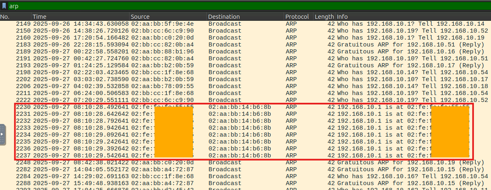
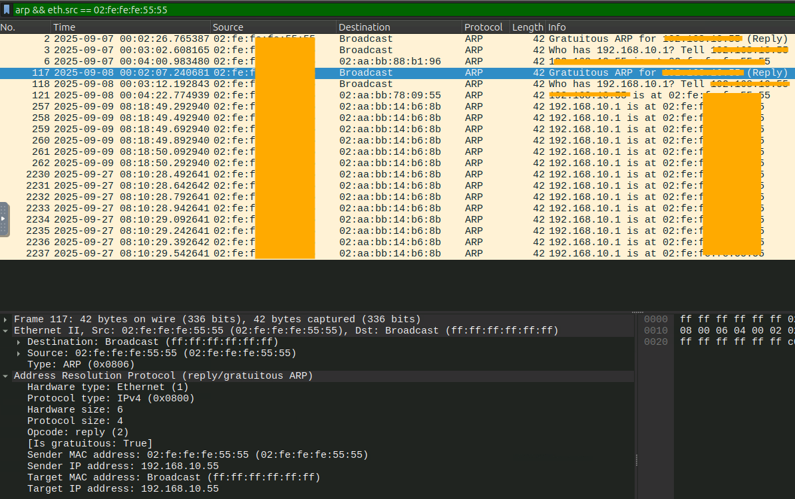
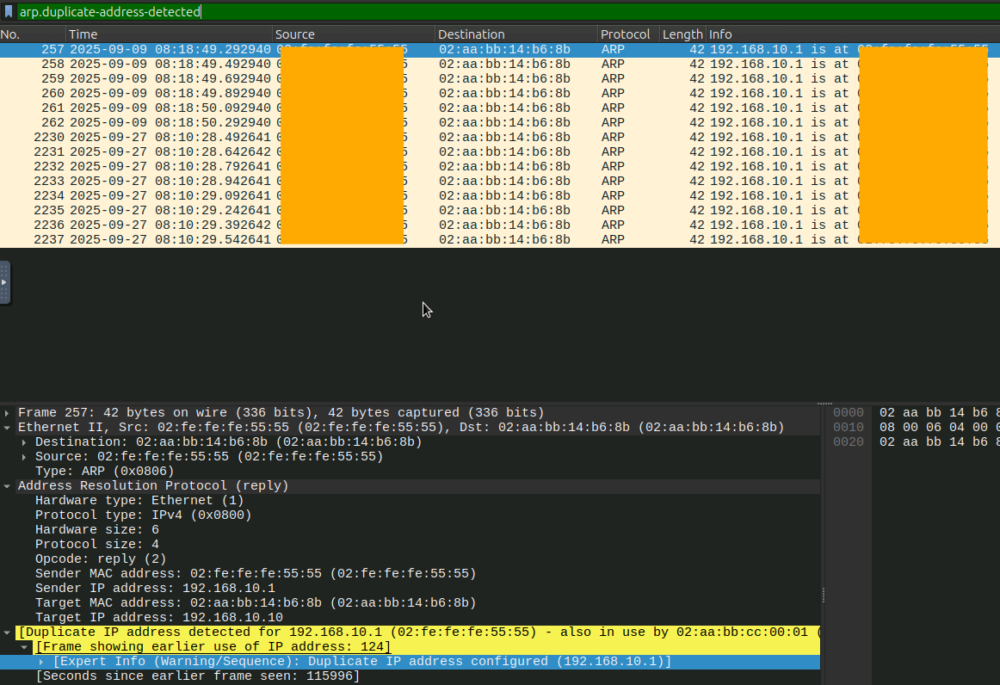
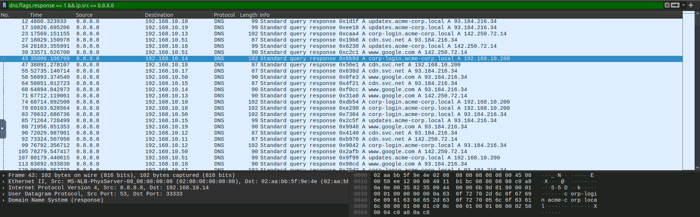
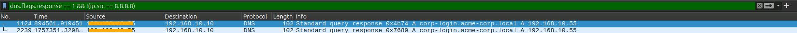

## MITM Attacks - An Overview

A Man-in-the-Middle (MITM): attack where an attacker secretly intercepts and potentially alters communication between two parties, without their knowledge. 

### Common Types of MITM Attacks
- Packet sniffing: Capturing unencrypted data packets exchanged over a network, often on open Wi-Fi
- Session hijacking: Stealing and using session tokens to impersonate users. 
- SSL stripping: Downgrading HTTPS connections to insecure HTTP to steal or alter data transferred
- DNS spoofing: Redirecting legitimate website traffic to fraudulent domains by manipulating DNS responses
- IP spoofing: Crafting malicious IP packets that appear to come from trusted system
- Rogue Wi-Fi access point: Creating fake networks to intercept user traffic 

## Detecting ARP Spoofing

It's important to remember that ARP has no authentication. Any device can send unsolicited is-at messages. It is a severe danger because an attacker can easily send spoofed ARP packets to redirect traffic through them. 

### Indicators of the Attack
- Duplicate MAC-to-IP Mappings: Multiple MAC addresses claiming the same IP address.
- Unsolicited ARP Replies: High number of ARP replies without matching requests ("gratuitous ARP").
- Abnormal ARP Traffic Volume: A Large number of ARP packets in short intervals.
- Unusual Traffic Routing: Traffic rerouted through the attacker's MAC.
- Gateway Redirection Patterns: Multiple destination MACs for the same gateway IP.
- ARP Probe / Reply Loops: Many ARP requests with `Who has 192.168.1.x? Tell 192.168.1.y` patterns.

| **Role** |           **IP**           |         **MAC**         |              **Notes**              |
| :------: | :------------------------: | :---------------------: | :---------------------------------: |
| Gateway  |        192.168.10.1        |    02:aa:bb:cc:00:01    |            Legit router             |
| Attacker |    192.\*\*\*.\*\*.*\*     | 02:fe:fe:\*\*:\*\*:\*\* | Trying to spoof gateway MAC address |
|  Victim  |       192.168.10.10        |    02:aa:bb:14:b6:8b    |                  -                  |
|  Domain  | corp-login.acme-corp.local |            -            |                  -                  |

I opted to eyeball the logs first to spot any obvious anomalies that commonly occur during ARP attacks. The first thing that caught my attention was several ARP replies within seconds from the same MAC address. Also upon deeper investigation, I spotted that Wireshark flagged these packets with the warning "Duplicate IP address detected...". Furthermore, the IP address announced in this reply belongs to the legitimate gateway, which may indicate that an attacker was trying to spoof its IP address to redirect traffic through their machine. 

I decided to take a closer look at the suspicious `02:fe:fe:**:**:**` MAC address. I spotted that the attacker's real IP address was `192.***.**.**`. 

---
**Useful filter in Wireshark to instantly spot frames with warning of "Duplicate IP address detected..." are:** `arp.duplicate-address-detected` or `arp.duplicate-address-frame`

## Unmasking DNS Spoofing

DNS spoofing occurs when an attacker crafts forged DNS packets and sends them to the victim's machine to poison its local cache, thereby redirecting traffic to a malicious website. 

### Indicators of the Attack
- **Multiple DNS responses for the same query**: A legitimate resolver and a forged responder reply to the same query. This is the single most reliable indicator.
- **DNS response from an unexpected source**: A DNS reply arrives from an IP address that does not match any configured resolver.
- **Suspiciously short TTL (Time-To-Live) values**: Attackers use very low TTLs (1 - 30s) to keep poisoned entries short-lived and reassert control.
- **Unsolicited DNS responses**: A DNS reply appears without a corresponding DNS request from the victim.

**1. Filtering on Legit traffic:**
Many companies use DNS servers that have static, designated IP addresses. It can be useful to isolate traffic based on these addresses to narrow down potential sources of DNS spoofing. Using the  
`dns.flags.response == 1 && ip.src == 8.8.8.8` display filter, we can observe what "normal" DNS responses look like for comparison. 

After establishing a "baseline", I was able to identify anomalous responses originating from a suspicious private IP address. Additionally, this response competed with the legitimate DNS response and redirected users to a cloned internal login page. What caught my attention was that the rogue DNS server and the resolved web server shared the exact same IP address - a dead giveaway for DNS spoofing. 

### Summary 
While network-based DNS spoofing is easily detected when enforcing a static pool of authorized resolvers, an adversary can bypass network detection entirely by **modifying the local `hosts` file**. Hardcoding malicious mappings directly on the victim machine allows them to hijack web traffic without generating a single DNS query across the wire. Another way of intervention in host's files is reconfiguring local network adapters or modifying  
`/etc/resolv.conf` to inject rogue DNS resolvers directly on the victim host.

## Spotting SSL Stripping in Action

SSL stripping is a man-in-the-middle technique in which an attacker intercepts and modifies traffic to remove or prevent TLS encryption between a client and a server. This causes the client to communicate over HTTP instead of HTTPS. This on-path tactic is a classic example of a downgrade attack, which occurs when an adversary forces a system to fall back to an insecure or weaker communication standard. 

### How It Works
**How SSL Stripping Actually Works:**
1. **The Initial Request:** The victim attempts to visit a secure website but initiates the connection over unencrypted HTTP (e.g., by typing the bare domain like `example.com`).
2. **MitM Interception & Forwarding:** Positioned on-path, the attacker intercepts this initial plaintext request and forwards it to the legitimate server over HTTP.
3. **The Server's Redirect:** The legitimate server responds with an upgrade directive  (`HTTP 301/302 Redirect: Location: https://...`).
4.  **Proxying and Rewriting:** The attacker intercepts this redirect and prevents it from reaching the victim. Instead, the attacker's proxy transparently follows the redirect, establishing a secure HTTPS connection with the server to retrieve the webpage  
(`200 OK`).
5. **Payload Modification:** Before forwarding the webpage back to the victim, the attacker parses the HTML body, rewriting all `https://` links to `http://` and stripping the `Secure` flag from any cookies.
6.  **Plaintext Delivery:** The attacker delivers the modified, cleartext HTML to the victim over the original HTTP session. The victim remains unaware of the downgrade, while the adversary sniffs submitted credentials in plaintext.

### Traffic Analysis
While training labs occasionally conflate DNS spoofing with SSL stripping, I’ve decided to skip taking screenshots of my actions to avoid confusing my readers. Instead, I’ll share practical Wireshark display filters along with detailed explanations:

`http.request` - Shows all outbound HTTP requests. If you spot requests going to domains that strictly use HTTPS (like banks, email providers, or login portals) being sent over plain HTTP, SSL stripping is highly likely.

`http.request.method == "POST"` - Filters for HTTP POST requests, which are used when a user submits a form. In this context, it allows you to intercept plaintext credentials or session tokens submitted by the victim.

`http.location contains "http://"` - Specifically looks for redirect headers that are pointing the browser to an insecure HTTP URL.

`http.response.code == 301 || http.response.code == 302` - Filters for HTTP redirects. After finding a redirect, it's crucial to right-click and follow the TCP stream to see if the attacker modified the `Location` header to point to an `http://` address instead of `https://`

``
