## Context & Objectives

This post is inspired by TryHackMe’s modules on Snort and its practical applications. While the lab scenarios were provided by THM, all analysis, configuration steps, and conclusions are entirely my own. We will go through each scenario step-by-step, breaking down the most crucial details. Because this post focuses more on practical skills, if you are unfamiliar with the fundamentals of IDS/IPS systems or Snort, I recommend checking out the foundational theory guides available on this blog or internet first. This lab is based on Snort 2. 

### First Interaction with Snort

To check whether the Snort is installed, we can use the following command;
```shell
snort -V
```

Before moving to the actual analysis, it's important to ensure that our configuration file is valid using the following command:
```shell
snort -c /etc/snort/snort.conf -T
```
The `-T` flag is used to test the configuration. 

 **Note:** \**snort.conf vs snort.lua; It is important to keep in mind that modern Snort 3 uses the snort.lua file instead of snort.conf*\*

**Some useful information that we can retrieve from the validation output:**
- Syntax Error Detection 
- Accurate File & Line Numbers
- Rule Counts
- Duplicate & Invalid SIDs
- IP Variable Scoping

When we want to quickly verify crucial details, it is important to note that Snort typically directs its `-T` validation output to `stderr`. For instance, if we want to check the number of loaded rules, we need to redirect `stderr` to `stdout` so we can parse it using `grep`.
This can be accomplished in two ways, depending on your Bash version:

**Older Bash versions:**
```shell
sudo snort -c /etc/snort/snort.conf -T 2>&1 | grep "Snort rules read" -A 5
```

**Modern Bash versions:**
```bash
sudo snort -c /etc/snort/snort.conf -T |& grep "Snort rules read" -A 5
```

Here is the example output:
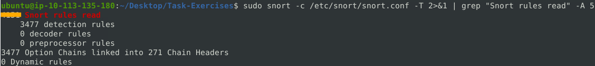

## Operation Mode 1: Sniffer Mode

**Some Sniffer Mode Parameters:**

| **Parameter** | **Description**                                                                                                             |
| ------------- | --------------------------------------------------------------------------------------------------------------------------- |
| `-v`          | Prints the basic information (source and destination IP addresses, ports, and packet types) in real time.                   |
| `-d`          | Shows the actual message payload (e.g., HTTP requests, text, or raw byte streams), rather than just address headers.        |
| `-e`          | Adds the hardware-level addresses (MAC addresses) to the output.                                                            |
| `-X`          | Shows the raw, unedited byte-by-byte view of the packet on the wire, formatted in hexadecimal side-by-side with ASCII text. |
| `-i`          | Tells Snort which network interface to watch.                                                                               |

After running Snort in verbose mode, it displays tcpdump-like output and the following summary upon interruption:
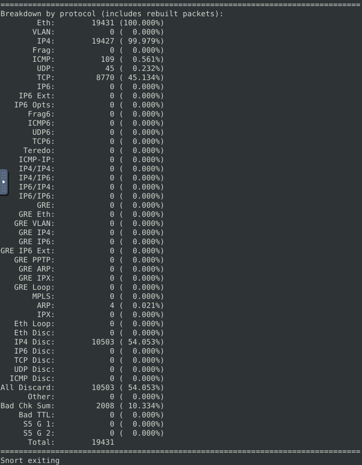

## Operation Mode 2: Packet Logger Mode

**Packet logger parameters explained:** 

| **Parameter** | **Description**                                                          |
| ------------- | ------------------------------------------------------------------------ |
| `-l`          | Targets log and alert output directory. The default is `/var/log/snort`. |
| `-K ASCII`    | Logs packets in ASCII format.                                            |
| `-r`          | Enables reviewing the logged events in Snort.                            |
| `-n`          | Specifies the number of packets to be processed or read.                 |

To analyze logged packets, we must take into consideration that Snort requires `sudo` to run, so all log files generated by this tool will be owned by the root account. Consequently, we need root privileges to inspect log files. 

**Note:** \**In real-world deployments, avoid running Snort directly as `root`. Instead, use a dedicated low-privileged system account and Linux capabilities (such as `CAP_NET_RAW`) to enforce the principle of least privilege.*\*

Upon executing the following command:
```bash
sudo snort -dev -K ASCII -l .
```
I observed several directories containing data in human-readable format, allowing me to inspect these files without needing Snort or tcpdump. The resulting structure can be seen below:
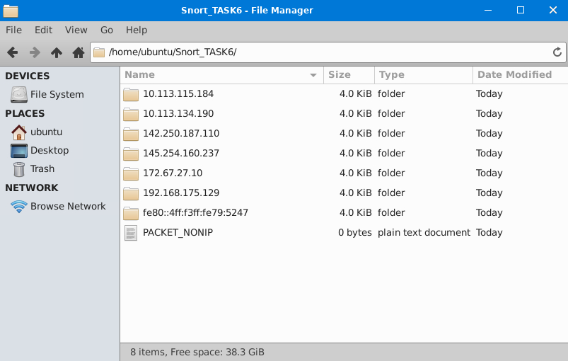
Inside these directories, the files are categorized by protocol and, where applicable, port numbers.
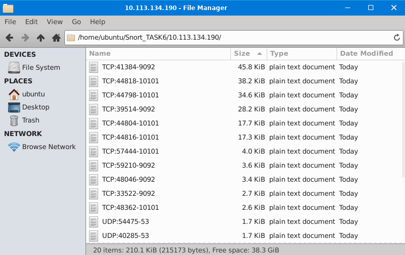
Opening these log files reveals granular, human-readable telemetry regarding the underlying network sessions.
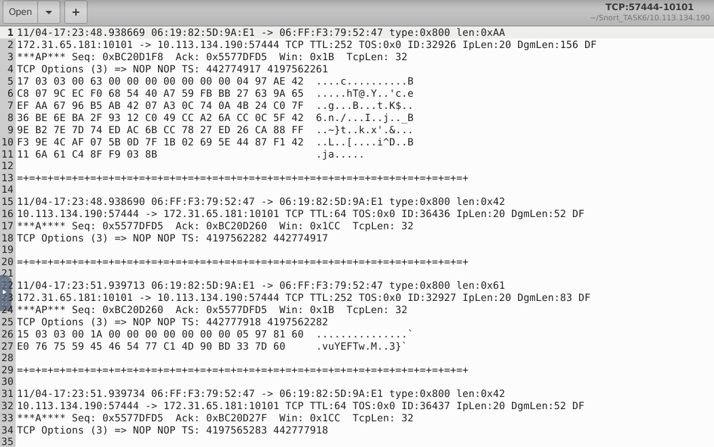
This is the same format as we saw in the packet sniffer verbose mode. 
### How to Navigate and Query These Files via CLI

Since these files are organized hierarchically by IP directory and protocol/port filenames, it's useful to combine **`find`**, **`grep`**, and **`tree`** to slice through the data efficiently:

- **Visualize the hierarchy instantly:** Instead of clicking through folders, use `tree` to see the layout up to a specific depth:
```bash
tree -L 2 /home/ubuntu/Snort_TASK6/
```
   
- **Locate specific files using `find`:** If you want to find all TCP files across all IP subdirectories:
```bash
find /home/ubuntu/Snort_TASK6/ -name "TCP*"
```

- **Or find files associated with a specific IP:**
```bash
find /home/ubuntu/Snort_TASK6/ -path "*10.113.134.190*"
```
Example output:
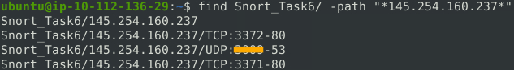

- **Search _inside_ the log files (`grep` or `ripgrep`):** If you are looking for a specific packet signature, string, or payload keyword across all IP directories simultaneously, use recursive grep (`-r`) or `ripgrep` (`rg` for speed):
```bash
grep -rn "Host:" /home/ubuntu/Snort_TASK6/
# Or using ripgrep:
rg "GET /" /home/ubuntu/Snort_TASK6/
```
**Note:** \**In real-world production environments, no one investigates alerts like this manually. Instead, enterprises utilize centralized log aggregation and correlation engines, such as SIEM platforms.*\*
### Analyzing log files via Snort
When Snort logs packets in binary (pcap) format rather than ASCII, it generates output files named with a Unix timestamp suffix (e.g., `snort.log.1698765432`). To read and inspect these logs directly within Snort, use the `-r` playback flag:
```bash
snort -r snort.log.<timestamp>
```
We can add the `-n` flag to specify how many packets to display:
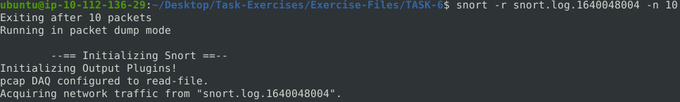

We can utilize any known flag from the previous examples. For instance, the `-X` flag displays the packet details in hexadecimal side-by-side with ASCII text:
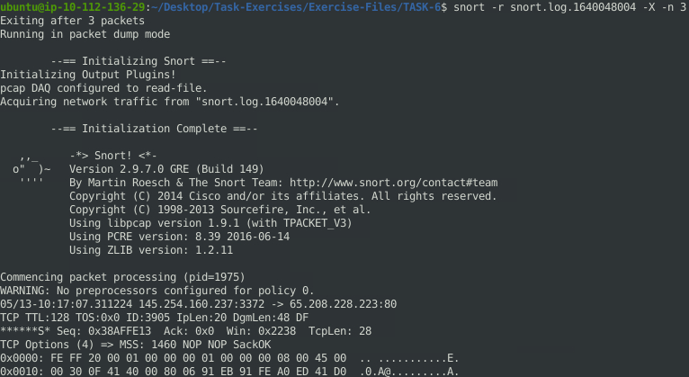

Furthermore, we can filter packet playback by appending Berkeley Packet Filters (BPF) directly to the command:
```bash
snort -r snort.log.<timestamp> 'tcp and port 80'
```

**Note:** \**Because these binary logs use standard `libpcap` formatting, they can also be ingested directly into Wireshark or parsed with `tcpdump -r`*\*

## Operation Mode 3: IDS/IPS

**NIDS mode parameters:**

| **Parameter** | **Description**                                                                  |
| ------------- | -------------------------------------------------------------------------------- |
| `-N`          | Disables logging (Alerts are still generated)                                    |
| `-D`          | Runs Snort in background/daemon mode                                             |
| `-A`          | Specifies alert mode: `full`, `fast`, `console`, `cmg`, `none`                   |
| `-c <file>`   | Path to the configuration file (loads active rulesets and preprocessors)         |
| `-q`          | Quiet mode (suppresses banners and initialization noise, outputting only alerts) |
| `-Q`          | Enables inline IPS mode (requires active packet-drop rules and compatible DAQ)   |

**Alert Modes Breakdown (`-A`):**
- **`console`**: Fast-style alerts printed directly to `stdout`.
- **`fast`**: Logs timestamp, alert message, classification, priority, and IP/ports to the `alert` file.
- **`full`**: Logs full packet header details alongside the alert message.
- **`cmg`**: Combines console alerting with raw payload display (hex + ASCII).
- **`none`**: Completely disables alert generation.

### IDS/IPS mode with parameter `-N`
Executing the following command:
```bash
sudo snort -c /etc/snort/snort.conf -N
```
Disables disk logging, preventing Snort from storing captured packet payloads into log files. However, real-time alert generation and preprocessor inspections remain fully functional. Below is the summary output upon session termination:
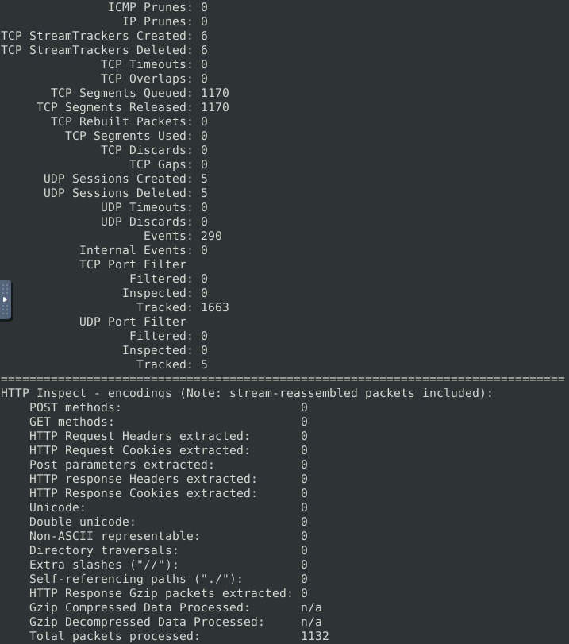

**Key Telemetry Insights:**
- **Stream Tracking & Session Reassembly:** Snort tracked and closed 6 TCP sessions   
  (`TCP StreamTrackers: 6`) and processed 1,170 segments. The absence of gaps   
  (`TCP Gaps: 0`) and overlaps (`TCP Overlaps: 0`) indicates a clean capture with no segment overlap anomalies in this sample.
- **Alert Generation with `-N`:** Despite payload logging being suppressed via `-N`, the detection engine still evaluated rules, registering alerts.
- **Application Layer Anomaly Detection:** The `HTTP Inspect` engine parsed layer 7 traffic without triggering normalization counters (zero directory traversals or encoding anomalies detected).

### IDS/IPS mode: "Using rule file without configuration file"
It is worth noting that we can point Snort directly to a standalone rules file instead of loading the full configuration file. This is especially useful for quickly testing and debugging custom rules in isolation:
```bash
sudo snort -c /etc/snort/rules/local.rules -A console -q
```

Example output:
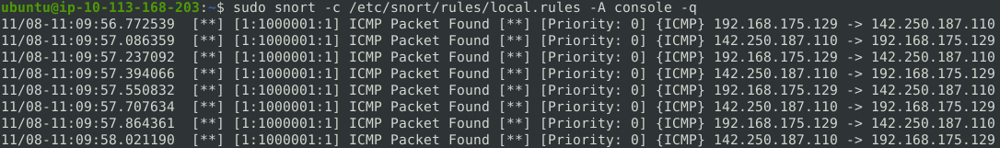

**Alert Breakdown:**
* **`11/08-11:09:56.772539`** – **Event Timestamp:** Precise packet arrival time down to the microsecond (`MM/DD-HH:MM:SS.usec`).
* **`[1:1000001:1]`** – **Rule Identifiers:**
  * **GID (`1`):** Generator ID, where `1` designates the core Snort rules subsystem (as opposed to preprocessors or decoders).
  * **SID (`1000001`):** Signature ID; IDs `1,000,000` and above are explicitly reserved for custom, locally defined rules.
  * **Rev (`1`):** Revision number, tracking rule modifications and iterations.
* **`ICMP Packet Found`** – **Alert Message:** The descriptive string defined inside the rule's `msg` option.
* **`[Priority: 0]`** – **Severity Level:** Default/unclassified priority level (Snort uses 1 for High, 2 for Medium, 3 for Low, with 0 denoting unassigned severity).
* **`{ICMP}`** – **Transport/Network Protocol:** The Layer 3/4 protocol matching the rule's protocol header.
* **`192.168.175.129 -> 172.67.27.10`** – **Traffic Direction:** Flow direction from the source IP address to the destination IP address (notice that port numbers are omitted since ICMP does not utilize transport ports).
### IPS mode and dropping packets
To demonstrate Snort's inline packet-dropping capabilities, I updated the rule action in the `local.rules` file from `alert` to `drop` and executed the following command:
```bash
sudo snort -c /etc/snort/rules/local.rules -q -Q --daq afpacket -i eth0:eth1 -A console
```
**Note:** \**Inline packet dropping requires Snort to bridge two network boundaries. Traffic arriving on the ingress interface (`eth0`) is buffered for signature inspection. If permitted, the DAQ forwards the frames through the egress interface (`eth1`); if a packet triggers a `drop` rule, forwarding is halted and the packet is silently discarded.*\*  
Example output:
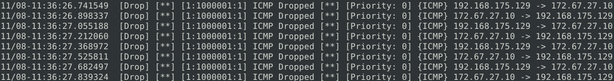
As shown above, Snort explicitly tags each alert with the `[Drop]` action, confirming that the offending transit packets were severed at the bridge boundary and discarded. 
## Operation Mode 4: PCAP Investigation

**PCAP Investigation parameters:** 

| **Parameter**        | **Description**                             |
| -------------------- | ------------------------------------------- |
| -r / -\-pcap-single= | Read a single pcap                          |
| -\-pcap-list=""      | Read multiple pcaps (space separated)       |
| -\-pcap-show         | Show pcap name on console during processing |

To demonstrate this functionality in action, I executed the following command against a captured traffic sample:
```bash
sudo snort -c /etc/snort/snort.conf -q -r icmp-test.pcap -A console -n 10
```
Example output:
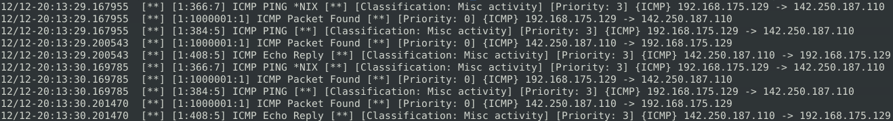
As is evident, the generated alert output is visually identical to Snort's default real-time NIDS behavior. However, it is crucial to remember that we are now performing forensic analysis on historical PCAP data rather than actively sniffing live network traffic. 

### Analytical Insights from the PCAP Telemetry
When reviewing this output from a forensic or DFIR (Digital Forensics and Incident Response) perspective, several interesting behaviors of the Snort detection engine become apparent:

- **1. Rule Overlap and Multi-Matching:** Notice that the first three alerts share the exact same microsecond timestamp (`12/12-20:13:29.167955`). This illustrates that a single inbound packet triggered our custom rule (`SID: 1000001`) alongside two built-in community rules (`SID: 366` and `SID: 384`). Snort's engine evaluates all loaded signatures independently, meaning one malicious packet can easily light up multiple distinct alerts on a SIEM dashboard.
    
- **2. Passive OS Fingerprinting (`*NIX`):** The alert `ICMP PING *NIX` is particularly fascinating. Snort isn't just looking at the ICMP protocol headers; it actively inspects the data payload. Different operating systems pad ICMP echo requests with distinct default payloads (e.g., Windows typically pads with the alphabet `abcd...`, while Linux/Unix utilizes timestamp data and specific hex patterns). Snort leverages these payload anomalies to automatically fingerprint the source OS without conducting active scans.
    
- **3. Bidirectional Flow Correlation & RTT:** By following the timestamps and IP directions, we can clearly trace the complete bidirectional session. The initial outbound `PING` (`...167955`) is followed shortly by an inbound `Echo Reply` (`...200543`). As a byproduct of this high-fidelity logging, an analyst can calculate the network Round-Trip Time (RTT) between these hosts directly from the IDS logs—approximately 32 milliseconds in this instance.
### Practical Validation & Telemetry Extraction
To wrap up the PCAP investigation module, I applied the previously discussed parameters to a set of practical exercises. The output below demonstrates how Snort extracts specific metrics from captured traffic and how varying configurations impact the detection engine:

1. **The Impact of Signature Tuning (`snort.conf` vs `snortv2.conf`):**  

First, I executed the following two commands:
```bash
# Baseline check with full community ruleset 
sudo snort -c /etc/snort/snort.conf -N -r mx-1.pcap 

# Targeted check with stripped-down configuration 
sudo snort -c /etc/snort/snortv2.conf -N -r mx-1.pcap
```

Then, I compared the alert statistics from both executions:
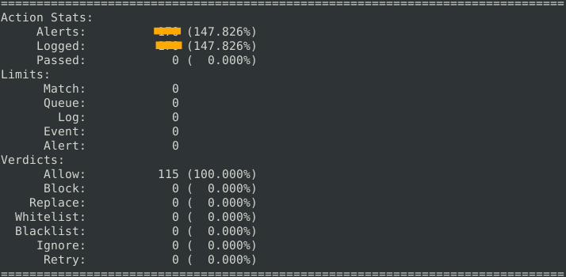

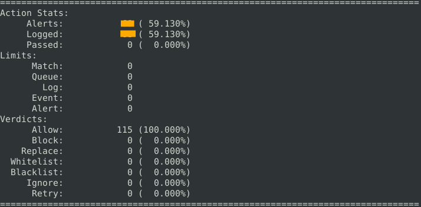
As expected, the second output reveals significantly fewer alerts. This stark contrast occurs because `snortv2.conf` is a heavily stripped-down configuration containing only a single, highly specific rule, whereas the default `snort.conf` evaluates the traffic against a massive database of over 4,100 generic community rules.

From a SecOps perspective, this perfectly illustrates the importance of rule granularity and strict selection. Relying solely on default, monolithic rulesets often floods a SIEM with noisy, irrelevant alerts. A mature SOC operates on custom-tailored configurations (loading only the specific signatures relevant to their infrastructure) to minimize false positives   
and prevent alert fatigue.

2. **Leveraging Preprocessor Telemetry:**  

Beyond alert counts, the telemetry output provides far more actionable data. For instance, thanks to Snort's stream and application-layer preprocessors, it actively reconstructs TCP sessions and parses Layer 7 protocols. This deep packet inspection is crucial for investigating advanced threats like web-based data exfiltration or malware Command and Control (C2) communications.
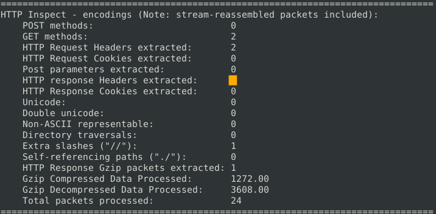

3. **Bulk PCAP Processing (`--pcap-list`):**   

In real-world Digital Forensics and Incident Response (DFIR) scenarios, analysts rarely investigate just one isolated packet capture. The following command demonstrates batch processing by passing multiple files simultaneously via the `--pcap-list` parameter:
```bash
sudo snort -c /etc/snort/snort.conf -N --pcap-list="mx-2.pcap mx-3.pcap"
```
This technique allows for seamless correlation of malicious activity across different timeframes or network segments.

## Snort Rule Structure

Every Snort signature consists of two primary logical blocks: the **Rule Header** (defining the action, protocol, IP addressing, and directionality) and the **Rule Options** (defining payloads, metadata, and alert logic). The first two mandatory fields of the header are the **Action** and the **Protocol**.

### Rule Actions
The action dictates how the Snort detection engine responds when traffic matches the signature criteria. Choosing the correct action is critical when transitioning from passive monitoring (IDS) to active inline blocking (IPS):

| Action       | Operational Behavior                                                                       |
| :----------- | :----------------------------------------------------------------------------------------- |
| **`alert`**  | Generates an alert event and logs the offending packet based on configured output plugins. |
| **`log`**    | Silently logs the packet to disk without generating an alert event.                        |
| **`drop`**   | Silently blocks and logs the transit packet.                                               |
| **`reject`** | Blocks the packet, logs it, and actively terminates the underlying session.                |

---
### Rule Protocols
The protocol parameter establishes the transport or network layer filtering primitive for the rule:

- **Snort 2 Primitive Boundaries:** Legacy Snort 2 headers strictly support only four core protocol keywords: **`ip`**, **`tcp`**, **`udp`**, and **`icmp`**.
- **Filtering Layer 7 Protocols (FTP, HTTP, SSH):** You cannot specify application-layer protocols directly in the header (e.g., writing `alert ftp ...` will trigger a syntax validation failure). To inspect higher-level services, analysts must evaluate the underlying transport protocol paired with the service's designated port and payload inspection buffers:  
	-  *Example (FTP Inspection):* To target File Transfer Protocol traffic, configure the header as `tcp` targeting port `21` (`tcp any any -> any 21`), and inspect the command payload inside the rule options.
- **Modern Evolution (Snort 3):** Unlike Snort 2, the modernized Snort 3 engine incorporates native service inspectors, allowing direct specification of application-layer protocols (such as `http`, `ftp`, or `ssl`) directly within the rule header.

---
### IP addresses, Port Numbers, and Directionality

Snort provides flexible notation to scope network boundaries within rule headers: 
- **Specific Host:** `192.168.1.56` - Evaluates a single IPv4 address. 
- **Subnet / CIDR:** `192.168.1.0/24` - Covers the entire Class C network block. 
- **Address Lists:** `[192.168.1.0/24, 10.0.0.0/8]` - Evaluates multiple subnets within brackets. 
- **Negation Operator (`!`):** `!192.168.1.56` - Matches any traffic *except* this specific address. 
- **Specific Port Number:** `22` - Targets a single, specific transport-layer port.
- **Exclude Specific Port Number:** `!22` - Inspects traffic on any port *except* the explicitly defined one.
- **Port Range (Explicit):** `1:1024` - Evaluates traffic falling within the defined inclusive range.
- **Port Range (Upper Limit):** `:1024` - Targets traffic from port 0 up to the specified boundary.
- **Port Range (Lower Limit):** `1024:` - Targets traffic from the specified boundary up to port 65535.
- **Specific Port List:** `[21, 23]` - Evaluates multiple, discrete ports simultaneously within brackets.
- **Directionality (`->` vs `<>`):** 
	- `->` *(Unidirectional)*: Alerts strictly on traffic flowing from source to destination. 
	- `<>` *(Bidirectional)*: Inspects conversational flow in both directions (useful for observing request/response pairs).

---
### General Rule Options 
The `options` section forms the logical core of a Snort signature, always enclosed within parentheses at the end of the rule header. Below are the fundamental metadata options required for proper rule management:
- **Msg:** Provides a human-readable identifier for the alert. When a signature triggers, this one-liner string is displayed in the console or forwarded to a SIEM, immediately summarizing the detected event or threat context for the analyst.
- **Sid:** The Snort Rule ID ensures global uniqueness for every signature. SIDs follow a strict numerical allocation framework:
	- `<100` - Reserved for internal Snort engine use.
	- `100 - 999 999` - Registered rules provided by Cisco Talos (VRT) or the official community rulesets.
	- `>= 1 000 000` - Reserved for local, user-created, or custom organizational rules.
- **Reference:** Injects external context directly into the alert. This is invaluable during incident triage, as it can link directly to a Common Vulnerabilities and Exposures (CVE) identifier (e.g., `reference:cve,2021-44228`), a Bugtraq ID, or an external threat intelligence URL explaining the attack vector.
- **Rev:** A simple integer tracking the modification iteration of a rule. Whenever a rule is updated (e.g., tuned to reduce false positives or optimized for performance), the author increments this number. Note that Snort does not provide native version control capabilities; `rev` simply acts as an indicator of the rule's lifecycle maturity.
---
### Payload Detection Rule Options
Payload detection parameters instruct the Snort engine to inspect the actual data encapsulated within network packets (Layer 7). Because Deep Packet Inspection (DPI) is computationally expensive, utilizing these options efficiently is critical for maintaining high IPS throughput.
- **`content`:** The cornerstone of payload inspection. It scans the packet's payload for specific ASCII strings, hexadecimal sequences, or a combination of both.
	- **ASCII Mode:** `content:"GET";`
	- **HEX Mode:** `content:"|47 45 54|";`
- **`nocase`:** A modifier that disables case sensitivity for the immediately preceding `content` keyword, allowing it to match variations like "GET", "get", or "GeT".
- **`fast_pattern`:** A crucial performance optimization modifier. By default, Snort's Fast Pattern Matcher selects the longest `content` string in a rule to perform the initial, rapid packet evaluation. If the longest string isn't the most unique, you can   
append `fast_pattern` to a shorter, highly unique `content` string to force the engine to use it first, significantly reducing CPU overhead.
---
### Non-Payload Detection Rule Options
Non-payload options evaluate network headers (Layers 3 and 4) to identify malformed packets, specific connection states, or evasion techniques without inspecting the application data.
- **`id`:** Filters for a specific IPv4 Identification field value. This is highly effective for detecting specific scanning tools, malware beacons, or covert channels that hardcode static IP IDs.
- **`flags`:** Evaluates TCP control flags. This is essential for detecting reconnaissance techniques like NULL, FIN, or XMAS stealth scans.
    - Supported flags include **F** (FIN), **S** (SYN), **R** (RST), **P** (PSH), **A** (ACK), and **U** (URG).
- **`dsize`:** Evaluates the size of the packet's payload. This is widely used to detect buffer overflow attempts or abnormally large packets (like the classic Ping of Death).
    - Syntax supports ranges (`dsize:min<>max`) and boundaries (`dsize:>100`, `dsize:<100`).
- **`sameip`:** A structural anomaly filter that triggers if a packet's Source IP perfectly matches its Destination IP.
--- 
### Practical Application

To solidify the concepts of non-payload detection, I utilized a set of scenario-based challenges against a sample PCAP file (`task9.pcap`). Rather than simply disclosing the final outputs, let's examine the exact Snort signatures required to extract this telemetry and the SecOps rationale behind them.

- **Scenario 1: Filtering Specific IP Identification (IP ID)**
	- **Objective:** Detect packets hardcoded with the specific IP ID `35369`.
	- **Snort Rule:**
```bash
alert ip any any -> any any (msg:"Test ID Detection"; id:35369; sid:1000010; rev:1;)
```

- **Scenario 2 & 3: Monitoring TCP State Transitions (Flags)**
	- **Objective:** Isolate packets carrying strictly the `SYN` flag, followed by a separate query for packets carrying both `PSH` and `ACK` flags.
	- **Snort Rule:**
```bash
# SYN rule:
alert tcp any any -> any any (msg:"SYN Flag Detected"; flags:S; sid:1000002; rev:1;)
# PSH-ACK rule:
alert tcp any any -> any any (msg:"PSH-ACK Detected"; flags:PA; sid:1000003; rev:1;)
```

- **Scenario 4: Detecting Structural Network Anomalies**
	- **Objective:** Identify UDP packets where the Source IP and Destination IP are identical.
	- **Snort Rule:**
```bash 
alert udp any any -> any any (msg: "SAME-IP Test"; sameip; sid:1000004; rev:1;)
```